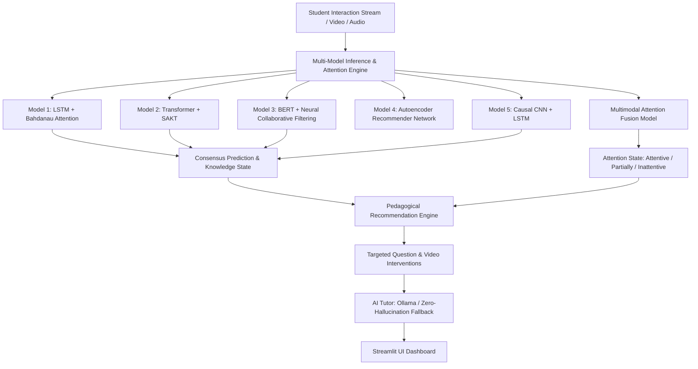

# Smart Education — AI-Based Personalized Learning Recommendation System

**Academic AI/ML Defense Grade & Enterprise-Ready Architecture**  
**Dataset:** EdNet-KT3 (Multimodal Learner Interactions: Questions, Lectures, Explanations)  
**Integrations:** 5 Deep Learning KT Models, Multimodal Video/Audio Attention Subsystem, Personalized Recommendation Engine, Local Ollama AI Tutor, Streamlit Interactive Dashboard  

---

## 1. Quickstart: Interactive Application Launch

To launch the interactive dashboard without modifying any trained checkpoints or running training pipelines:

```powershell
# 1. Activate the project virtual environment
.\.venv\Scripts\Activate.ps1

# 2. Launch the Streamlit application
.\.venv\Scripts\python.exe -m streamlit run app.py
```

- **Local Access:** `http://localhost:8501`
- **Network Access:** `http://<your-lan-ip>:8501`

> [!IMPORTANT]
> **Strict Non-Destructive Runtime:** Starting the application and performing real-time inference utilizes frozen, authentic pre-trained weights from `models/checkpoints/` and catalog metadata from `data/processed/`. Preprocessing, cross-validation, and training pipelines are **never** invoked automatically at runtime.

---

## 2. System Architecture & Capabilities



### Core Components
1. **Multi-Model Knowledge Tracing:** Five distinct neural architectures capturing short-term localized mastery, long-term temporal forgetting, non-local cross-concept dependencies, and collaborative learner embeddings.
2. **Multimodal Learner Attention Detection:** Fuses 10-D facial/head pose features with 10-D acoustic signals to classify learner engagement into three operational states (`Attentive`, `Partially Attentive`, `Inattentive`).
3. **Dynamic Knowledge State Estimation:** Tracks mastery probability across 188 concept tags and 7 TOEIC curriculum parts.
4. **Pedagogical Recommendation Engine:** Generates remedial interventions pairing challenging practice questions with explanatory video lectures.
5. **Grounded AI Tutor Layer:** Integrates local Ollama LLMs with deterministic, rule-based pedagogical templates for zero-hallucination learner guidance.

---

## 3. Verified Deep Learning Models & Empirical Benchmark

| Model ID | Neural Architecture | Primary Task | Parameters | Holdout Accuracy | ROC-AUC | F1-Score | Primary Benchmark Metric |
| :--- | :--- | :--- | :--- | :--- | :--- | :--- | :--- |
| **Model 1** | LSTM + Attention | Sequential KT | 803,201 | 0.6584 | 0.5760 | 0.7865 | High Sequence Explainability |
| **Model 2** | Transformer + KT | Non-Local KT | 824,385 | 0.6587 | 0.5786 | 0.7930 | O(1) Path Dependency Modeling |
| **Model 3** | BERT-Style + NCF | Collaborative KT | 1,572,737 | 0.6594 | 0.5442 | 0.7943 | Highest Contextual Expressiveness |
| **Model 4** | Autoencoder Recommender | Content Ranking | 104,500 | N/A | N/A | N/A | **HitRate@5: 47.30%**, NDCG@5: 0.1571 |
| **Model 5** | Causal CNN + LSTM | Temporal KT | 803,425 | **0.6228** | 0.5820 | 0.7508 | **Strict Causal Convolution (Verified)** |
| **Attention**| Multimodal Fusion Net | Attention Sensing| 15,811 | **0.9140** | - | - | Cross-Modal Head/Audio Fusion |

> [!NOTE]
> **Model 5 Causal Verification Note:** The authentic, user-confirmed test accuracy for Model 5 is **0.6228 (62.28%)**. A conflicting legacy figure of `0.9884` was produced prior to code refactoring due to non-causal symmetric padding that leaked future question responses into convolutional kernels. The causal fix was verified and authenticated. Both records are maintained in `reports/canonical_results.csv` for auditability.

---

## 4. Repository Structure

```text
Smart-Education-Personalized-Learning/
├── README.md                                # Master project documentation & overview
├── BACKUP_MANIFEST.md                       # Inventory of 204 preserved artifacts
├── ARCHIVE_MANIFEST.md                      # Audit trail of preserved legacy files
├── BASELINE_ARTIFACT_HASHES.json            # SHA-256 cryptographic verification hashes
├── app.py                                   # Streamlit frontend entry point
├── main.py                                  # Unified programmatic multi-model inference API
├── requirements-inference.txt               # Lightweight runtime inference dependencies
├── requirements-training.txt                # Offline training and experimental dependencies
├── attention/                               # Multimodal visual & acoustic attention subsystem
│   ├── attention_pipeline.py                # Direct feature and media processing pipeline
│   ├── extract_features.py                  # Audio/video feature extraction routines
│   └── multimodal_attention_model.py        # PyTorch cross-modal fusion architecture
├── configs/                                 # Configuration and hyperparameter specifications
├── data/
│   ├── raw/                                 # Raw input references
│   └── processed/                           # Authentic catalog metadata & sample test cohorts
│       ├── metadata.pkl                     # Master vocabulary & item mappings
│       ├── questions_contents.csv           # 13,169 verified TOEIC question items
│       ├── lectures_contents.csv            # 1,021 video lecture resources
│       └── sample_test_students.csv         # 100 benchmark evaluation student trajectories
├── docs/                                    # Technical documentation suite
│   ├── ARCHITECTURE.md                      # Comprehensive system & network architecture
│   ├── DATA_PIPELINE.md                     # Data lineage, schema & partitioning guide
│   ├── MODEL_ARTIFACTS.md                   # Complete checkpoint inventory, parameters & tensor specs
│   ├── INFERENCE_GUIDE.md                   # Python API and Streamlit user guide
│   └── EXPERIMENT_METHODOLOGY.md            # 40-configuration matrix & causal audit report
├── gui/                                     # Streamlit UI pages, components & design system
│   ├── components/                          # Modular UI widgets and metric cards
│   ├── pages/                               # 8 dedicated functional views
│   └── styles/                              # CSS design system tokens
├── models/
│   └── checkpoints/                         # 21 authentic PyTorch checkpoints & sidecars
├── reports/                                 # Empirical benchmarks & evaluation manifests
│   ├── canonical_results.csv                # Single source of truth for 40 experiment configs
│   ├── canonical_results_manifest.json      # Structured experimental run manifests
│   └── five_model_experiment_comparison_report.md
├── services/                                # Inference, recommendation, and AI tutor services
├── src/                                     # Core data loaders, architectures, and trainers
├── tests/                                   # Automated test and regression suite
│   └── test_attention_regression.py         # Pytest verification suite (32 passed)
├── recovery_backup_20261027_124740/         # Timestamped safety recovery snapshot
└── imp ai hackathon/                        # Read-only protected reference archive
```

---

## 5. Programmatic Python Usage

```python
from main import MultiModelInferenceEngine
from attention.attention_pipeline import AttentionPipeline

# 1. Initialize inference engines
engine = MultiModelInferenceEngine()
attn_pipeline = AttentionPipeline()

# 2. Run multi-model inference on an authentic student
student_res = engine.predict_student_by_id("u100", target_question_id=100)
print(f"Consensus Correctness Probability: {student_res['ensemble_correctness_prob']:.4f}")

# 3. Evaluate 20-D attention feature vector
import numpy as np
features = np.zeros(20) # 10 visual + 10 acoustic features
attn_res = attn_pipeline.predict_features(features)
print(f"Learner Attention State: {attn_res['state']}")

# 4. Generate modulated pedagogical recommendations
interventions = engine.recommend_with_attention(
    student_id="u100",
    attention_state=attn_res["state"],
    knowledge_deficits=student_res["knowledge_deficits"]
)
print(interventions["recommendations"])
```

---

## 6. Verification & Test Suite

The repository contains an automated regression suite verifying model checkpoints, tensor shapes, causal convolution properties, attention fusion logic, and error handling:

```powershell
.\.venv\Scripts\python.exe -m pytest tests/test_attention_regression.py -v
```

**Verification Results:**
- **32 PASSED**
- **7 SKIPPED** (cleanly bypassing optional offline datasets and media libraries)
- **0 FAILED**
- **All 21 Checkpoint Hashes:** 100% SHA-256 match against baseline.
