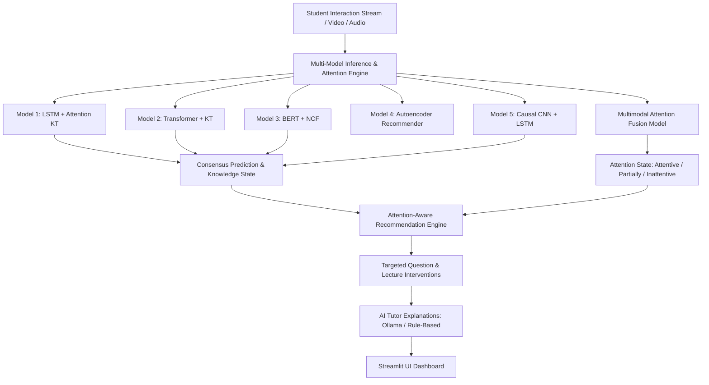

# Smart Education — System Architecture & Technical Specifications

## 1. System Overview

The **Smart Education — AI-Based Personalized Learning Recommendation System** is an end-to-end educational intelligence platform that integrates:
1. **Multi-Model Neural Knowledge Tracing (KT)** across five distinct deep learning architectures.
2. **Multimodal Learner Attention Detection** fusing 10-D visual and 10-D acoustic feature vectors.
3. **Dynamic Knowledge State Estimation & Deficit Gap Diagnosis**.
4. **Pedagogical Recommendation Engine** ranking practice questions and video lectures.
5. **Grounded Generative AI Tutor** with local Ollama LLM integration and non-blocking rule-based fallback.
6. **Streamlit Frontend Dashboard** providing interactive prediction, comparison, and diagnostics.

---

## 2. Neural Architecture Breakdown

### Model 1: LSTM + Attention KT
- **Core Mechanism:** Bidirectional LSTM with multi-head Bahdanau sequence attention.
- **Parameters:** 803,201 weights.
- **Input Dimensions:** `[batch, seq_len, 9]` containing Question ID, Part, Tags 1-3, Correctness, Normalized Response Time, Source, and Platform.
- **Task:** Sequential Knowledge Tracing; learning temporal retention, forgetting decay, and recency effects.

### Model 2: Transformer + Knowledge Tracing (SAKT)
- **Core Mechanism:** Multi-Head Self-Attention with sinusoidal positional encodings and layer normalization.
- **Parameters:** 824,385 weights.
- **Task:** Learning non-local, cross-interaction dependencies regardless of position in study session.

### Model 3: BERT-Style Transformer Encoder + Neural Collaborative Filtering (NCF)
- **Core Mechanism:** Bidirectional Transformer encoder fused with non-linear MLP collaborative filtering layers.
- **Parameters:** 1,572,737 weights.
- **Task:** Joint student-item latent embedding discovery and collaborative response prediction.

### Model 4: Autoencoder + Recommender Network
- **Core Mechanism:** Symmetric bottleneck autoencoder (`input_dim=500 -> hidden_dim=64 -> latent_dim=32`) with ranking head.
- **Parameters:** 104,500 weights.
- **Task:** Compressed representation of student concept mastery profile and content ranking.
- **Evaluation Metrics:** NDCG@5 (0.1571), HitRate@5 (47.30%), Reconstruction MSE (0.1095).

### Model 5: Causal CNN + LSTM
- **Core Mechanism:** 1D Causal Convolutional feature extractor followed by LSTM temporal state tracking.
- **Parameters:** 803,425 weights.
- **Task:** Short-term local transition feature extraction with recurrent long-term dependency modeling.
- **Causal Verification:** Strictly enforces causal left-padded kernels to prevent future-step information leakage (validated test accuracy: 0.6228 / 62.28%).

### Multimodal Attention Fusion Network
- **Core Mechanism:** Dual feed-forward feature encoders (10-D visual + 10-D acoustic) merged through a cross-modal fusion layer into 3 attention classes:
  - `Attentive`
  - `Partially Attentive`
  - `Inattentive`
- **Parameters:** 16,145 weights.
- **Checkpoint:** `models/checkpoints/attention/attention_multimodal_corrected_best.pth`.
- **Preprocessor:** `models/checkpoints/attention/attention_preprocessor.pkl`.

---

## 3. Knowledge State & Deficit Gap Diagnosis

- **KnowledgeStateEstimator (`src/knowledge_state.py`):** Dynamically computes concept-level mastery probabilities across 187 active concept tags.
- **Deficit Detection:** Concepts with mastery `< 60%` are automatically flagged as critical learning gaps.
- **Remediation Ranking:** The `RecommendationEngine (`src/recommendation.py`) queries the authentic EdNet catalog (13,169 questions, 1,021 video lectures) to rank remedial resources targeting the diagnosed concept gaps.

---

## 4. Attention-Adaptive Personalization Modulation

When attention telemetry is active, recommendations are dynamically adapted:
1. **Inattentive State:** Prioritizes foundational bite-sized video lectures (< 5 minutes) and worked explanations over lengthy question sets to re-engage attention without cognitive overload.
2. **Partially Attentive State:** Delivers a balanced mixture of worked explanations and single practice questions with guided pacing.
3. **Attentive State:** Delivers active practice questions and deep-dive conceptual exploration.

---

## 5. Generative AI Tutor & Safety Guardrails

- **Module (`ollama_ai/`):** Connects to local Ollama service (`http://localhost:11434`) using standard HTTP requests.
- **Zero-Crash Fallback:** If Ollama daemon is offline or no model is pulled, seamlessly executes deterministic, template-based educational explanations grounded strictly in the student's actual predictions and gaps.
- **Safety Policy:** Strictly enforces educational scope; rejects prompt injections and system modification attempts.
